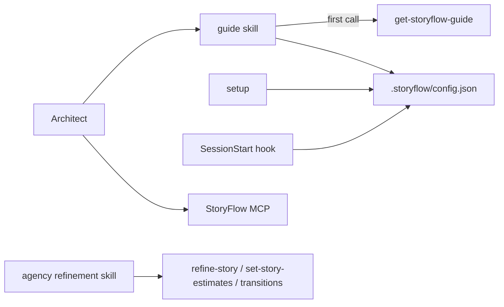

# Refinement is a skill, StoryFlow keeps only saving it

Status: accepted, 2026-10-16. Supersedes the `refine-story` / `refine-briefing` bullet of the decision in `2026-08-24-plugin-scope.md`.

## Context

The plugin-scope decision kept `/storyflow:refine-story` and `/storyflow:refine-briefing` as machinery: they dispatched subagents and synthesised the result, while the method itself (perspectives, scoring, document format, workflow) came from `get-refinement-guidelines`. From 8.3.0 the commands carried no steps of their own at all, only the instruction to follow what that tool returned.

Refinement is becoming a skill that does far more than a list of steps. A method served by StoryFlow competes with it: any agent that loads the MCP server and reads the guide is told the served method is the source of truth. StoryFlow therefore stops serving one (backend story WDVLP-724), and with the tool gone both commands fail on their first call.

## Decision

The plugin no longer refines. Both commands are removed. Refinement is a skill outside this plugin; StoryFlow provides only what that skill needs to write: `refine-story` to save the document, `set-story-estimates` for the story points and attention estimate, and the transitions. The in-app refinement is unaffected.

## Rejected alternatives

**Ship WeDevelop's refinement skill in this plugin.** It needs Herdr and a branding plugin and carries WeDevelop's house style. This plugin is public and white-label: every agency on StoryFlow installs it, so it cannot carry one agency's method or tooling.

**Keep the commands with a method of their own.** That is the competing method this decision removes, moved from StoryFlow into the plugin.

## Consequences

- Two commands disappear: a major release with no deprecation window, as in 8.0.0.
- The release lands in the marketplace **before** the backend removes `get-refinement-guidelines`. It stops using a tool, so it does not wait on a backend deploy; the backend waits on it.
- An architect who does not update keeps the old commands, which answer "tool not found" once the backend change is live.
